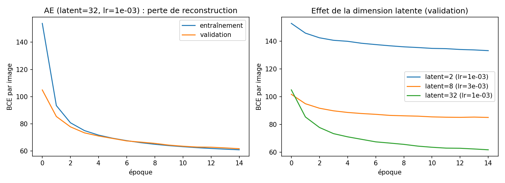
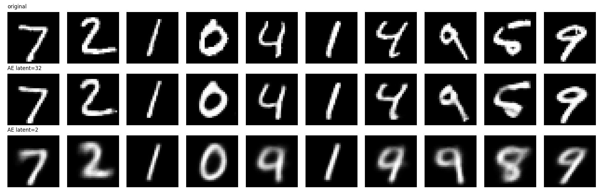
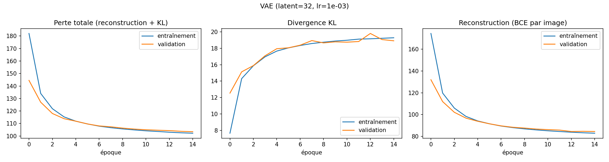
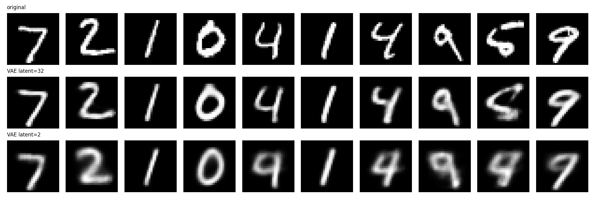
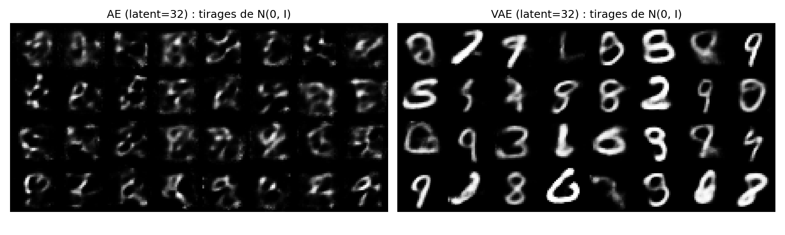
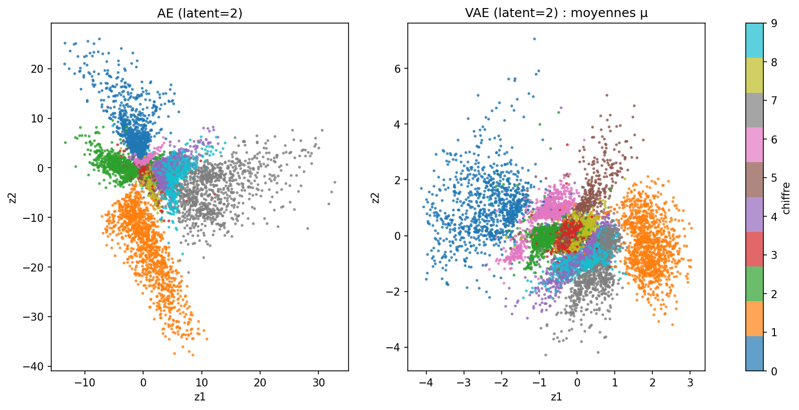
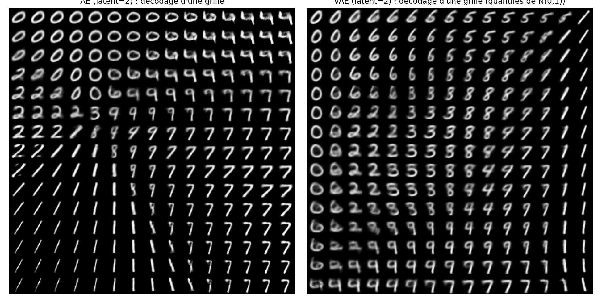
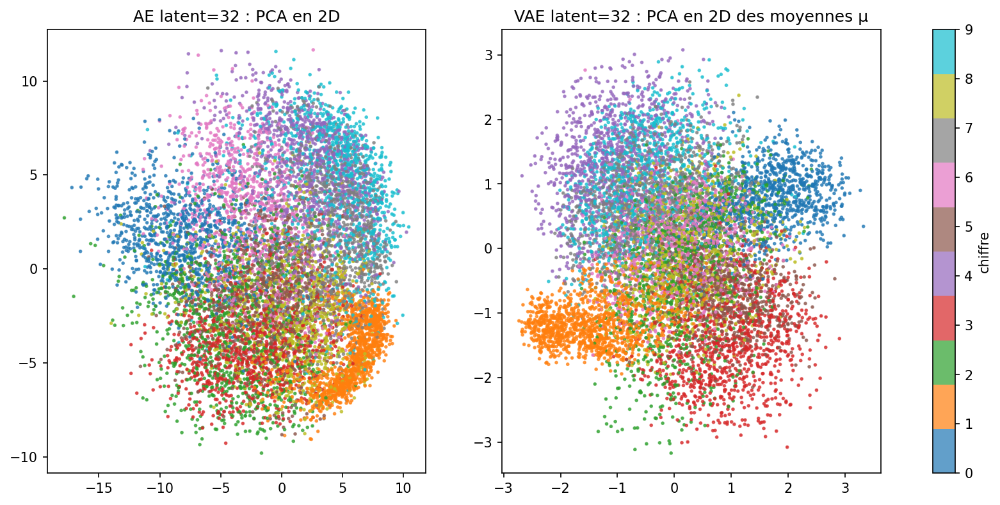

# Lab 4 – Deep Learning : modèles génératifs (AE, VAE, GAN)

**Université Abdelmalek Essaadi – FST Tanger**

**Module :** Deep Learning – Pr. Elaachak Lotfi

**Étudiante :** RAHELIARISOA Andriamasy Lorraine Agnès

## Objectif
Construire un auto-encodeur (AE) et un auto-encodeur variationnel (VAE) sur MNIST, comparer leurs
reconstructions et leurs espaces latents, puis entraîner un GAN pour générer des peintures abstraites.

## Contenu du dépôt
| Fichier | Rôle |
|---|---|
| `notebooks/01-ae-vae-mnist.ipynb` | AE et VAE sur MNIST : recherche d'hyperparamètres, évaluation, espace latent |
| `notebooks/02-gan-abstract-art.ipynb` | GAN sur Abstract Art Gallery |
| `results/` | courbes, reconstructions, espaces latents, tableaux (`.csv`, `.json`), images générées |
| `requirements.txt` | bibliothèques Python utilisées |

**Environnement :** Kaggle (GPU), PyTorch. Graine fixée à 42. Les poids des modèles ne sont pas versionnés.

---

# Partie 1 : AE et VAE (MNIST)

## 1.1 Données et protocole
MNIST (60 000 images d'entraînement, 10 000 de test), lu depuis les fichiers IDX du dataset Kaggle.
Découpage : **54 000 entraînement / 6 000 validation** (graine 42, comme dans les labs précédents), et
10 000 images de test utilisées uniquement pour les résultats finaux. Les pixels sont normalisés dans
[0, 1] et les images de 28×28 sont aplaties en vecteurs de 784 valeurs (réseaux denses).

Entraînement : Adam, lots de 128, **15 époques**, graine 42 pour tous les modèles. Les hyperparamètres
sont choisis sur la validation.

**Perte de reconstruction :** entropie croisée binaire (BCE) sommée sur les 784 pixels et moyennée sur
les images (« BCE par image »), la même pour l'AE et le VAE. L'erreur quadratique moyenne par pixel
(EQM) est suivie en complément.

## 1.2 Auto-encodeur (AE)

| Partie | Couches |
|---|---|
| Encodeur | 784 → 512 → 256 → code latent (activations ReLU) |
| Décodeur | code latent → 256 → 512 → 784 (ReLU ; sortie en logits, sigmoïde dans la perte) |

**1 083 696 paramètres** pour un code de dimension 32.

**Recherche d'hyperparamètres.** Dimension latente {2, 8, 32} × taux d'apprentissage {1e-3, 3e-3},
sélection sur la BCE de validation (dernière époque).

| Latent | lr | BCE validation | EQM validation | Temps (s) |
|---|---|---|---|---|
| 2 | 1e-3 | 133,16 | 0,03610 | 14,5 |
| 2 | 3e-3 | 134,30 | 0,03662 | 13,9 |
| 8 | 1e-3 | 85,63 | 0,01548 | 14,0 |
| 8 | 3e-3 | 85,02 | 0,01517 | 14,0 |
| **32** | **1e-3** | **61,71** | **0,00571** | 13,8 |
| 32 | 3e-3 | 62,11 | 0,00590 | 14,2 |

**Modèle retenu : dimension latente 32, lr = 1e-3.** Résultat sur le test : **BCE 61,12, EQM 0,00557**.

**Observations.**
- **La dimension latente domine** : la BCE passe de 133 (2 dimensions) à 85 (8) puis 62 (32). Le taux
  d'apprentissage joue très peu (moins de 1,2 point d'écart, et le meilleur n'est pas le même pour
  toutes les dimensions) : avec une seule graine, ce choix n'est pas significatif.
- **Pas de surapprentissage** : les courbes d'entraînement et de validation se superposent, et la perte
  de test (61,12) est proche de celle de validation (61,71). La perte d'entraînement de la première
  époque est plus élevée car elle est moyennée sur l'époque, alors que celle de validation est mesurée
  en fin d'époque. La perte baisse encore légèrement à la 15e époque : l'entraînement n'est pas
  totalement convergé.
- **Reconstructions** : avec 32 dimensions, elles sont quasi identiques aux originaux ; avec 2
  dimensions, elles sont floues et confondent des chiffres proches (4 reconstruit en 9 à deux reprises,
  5 en 8) : deux nombres ne suffisent pas à coder l'identité d'un chiffre.
- **« Meilleur » signifie ici « meilleure reconstruction parmi les valeurs testées »** : 32 est la plus
  grande dimension essayée, on ne peut pas affirmer que c'est un optimum.

## 1.3 Auto-encodeur variationnel (VAE)

| Partie | Couches |
|---|---|
| Encodeur | 784 → 512 → 256 (ReLU), puis deux couches linéaires donnant la moyenne μ et le log-variance log σ² |
| Échantillonnage | z = μ + σ · ε avec ε ~ N(0, I) (astuce de reparamétrisation) |
| Décodeur | identique à celui de l'AE |

**1 091 920 paramètres** pour un code de dimension 32. **Perte = BCE de reconstruction + β · KL**, avec
β = 1 et KL = KL(q(z|x) ‖ N(0, I)) sommée sur les dimensions et moyennée sur les images.

**Recherche d'hyperparamètres.** Même grille que pour l'AE. La sélection se fait sur l'**ELBO de
validation** (reconstruction + KL), seul critère comparable entre configurations.

| Latent | lr | Reconstruction | KL | ELBO validation | Temps (s) |
|---|---|---|---|---|---|
| 2 | 1e-3 | 137,07 | 6,52 | 143,59 | 19,6 |
| 2 | 3e-3 | 137,92 | 6,57 | 144,50 | 19,2 |
| 8 | 1e-3 | 90,48 | 16,36 | 106,84 | 19,2 |
| 8 | 3e-3 | 91,97 | 16,19 | 108,17 | 19,2 |
| **32** | **1e-3** | **84,52** | **18,92** | **103,44** | 19,4 |
| 32 | 3e-3 | 91,63 | 16,94 | 108,57 | 19,3 |

**Modèle retenu : dimension latente 32, lr = 1e-3.** Résultat sur le test : reconstruction **83,45**,
KL **18,95**, ELBO **102,40**, EQM 0,01477. Seules **11 dimensions sur 32 sont « actives »** (variance
de μ sur les images de validation supérieure à 0,01) : les 21 autres sont ignorées par le modèle
(effondrement du posterior).

**Observations.**
- La divergence KL augmente au début (le codeur transmet de l'information sur l'image) puis se
  stabilise autour de 19 ; reconstruction et KL ne présentent pas de surapprentissage, et les pertes
  baissent encore légèrement en fin d'entraînement.
- Contrairement à l'AE, le taux d'apprentissage 1e-3 est meilleur dans les trois dimensions testées
  (écart de 5 points d'ELBO pour la dimension 32).

## 1.4 Évaluation et comparaison AE / VAE

| Modèle (latent 32) | BCE de reconstruction (test) | EQM (test) | KL (test) |
|---|---|---|---|
| AE | **61,12** | **0,00557** | – |
| VAE | 83,45 | 0,01477 | 18,95 |

**Analyse.**
- **L'AE reconstruit mieux que le VAE** (BCE 61 contre 83, EQM 0,0056 contre 0,0148). C'est attendu :
  le VAE paie un coût de régularisation (le terme KL) et n'utilise que 11 dimensions sur 32 ; sa
  reconstruction de validation (84,5) est du niveau de celle d'un AE à 8 dimensions (85,0 à 85,6).
- **Le VAE génère, l'AE non.** En décodant 32 codes tirés d'une loi N(0, I), l'AE produit des traits
  sans forme, alors que le VAE produit des chiffres reconnaissables (8, 7, 9, 2, 5, 3, 0...), avec
  quelques formes ambiguës. L'AE n'a aucune raison d'avoir organisé son espace latent comme une loi
  normale. Ce test est un peu défavorable à l'AE : une comparaison plus juste tirerait ses codes selon
  leur distribution réelle.
- Les valeurs de perte ne sont comparables entre l'AE et le VAE que sur la reconstruction : l'ELBO du
  VAE inclut la KL, que l'AE n'a pas.

## 1.5 Espace latent

Les nuages ci-dessous utilisent des modèles à **2 dimensions** (AE : lr 1e-3, VAE : lr 1e-3) ; pour le
VAE, les points sont les moyennes μ.

Pour mesurer à quel point les classes sont séparées dans l'espace latent, un classifieur des 5 plus
proches voisins est entraîné sur 20 000 codes d'entraînement et testé sur les 10 000 codes de test.

| Modèle | Accuracy k-NN (k = 5) |
|---|---|
| AE, 2 dimensions | 0,786 |
| VAE, 2 dimensions | 0,755 |
| AE, 32 dimensions | 0,971 |
| VAE, 32 dimensions | 0,957 |

**Analyse.**
- **AE (2 dimensions)** : le nuage prend la forme d'une étoile à larges branches (0 en haut à gauche,
  1 vers le bas, 7 à droite, 2 à gauche) sur une grande plage de valeurs (z1 d'environ −13 à 33, z2
  d'environ −38 à 26), avec un centre encombré où se mêlent 3, 4, 5, 8 et 9. L'échelle est arbitraire.
- **VAE (2 dimensions)** : le nuage est plus compact et centré près de 0 (environ −4 à 3 et −4 à 7),
  car le terme KL le rapproche de N(0, I). Les classes se recouvrent aussi au centre.
- **Décodage d'une grille** : pour le VAE, toute la grille décode vers des chiffres plausibles avec des
  transitions continues, et les dix chiffres apparaissent. Pour l'AE, les transitions sont aussi
  continues, mais la grille est dominée par 0, 2, 4/9, 7 et 1, avec des formes déformées dans certaines
  zones : rien n'oblige l'AE à remplir l'espace.
- **Séparabilité (k-NN)** : les codes de l'AE sont un peu plus séparables que ceux du VAE (0,786 contre
  0,755 en 2 dimensions, 0,971 contre 0,957 en 32). Le VAE sacrifie un peu de séparabilité, comme de
  reconstruction, pour obtenir un espace régulier dans lequel on peut échantillonner. Ces écarts de 1
  à 3 points, obtenus avec une seule graine, sont à interpréter avec prudence.
- **2 contre 32 dimensions** : l'accuracy passe de 0,79 à 0,97 ; deux dimensions ne contiennent pas
  assez d'information pour séparer les chiffres, ce qui rejoint les reconstructions floues.
- **PCA des modèles à 32 dimensions** : la projection linéaire en 2D montre un fort recouvrement des
  classes (seuls 0 et 1 se détachent). La PCA ne conserve qu'une partie de la variance : une
  méthode non linéaire (t-SNE, UMAP) montrerait mieux la structure, elle n'a pas été utilisée ici.

## 1.6 Conclusion et limites

L'AE est le meilleur pour reconstruire des images, le VAE est le seul des deux à pouvoir générer de
nouveaux chiffres, au prix d'une reconstruction plus floue et d'un usage partiel de son espace latent.

**Limites.**
- Une seule graine, 15 époques (pertes encore légèrement décroissantes) et une grille de 6
  configurations par modèle ; β fixé à 1 (non optimisé) ; réseaux denses uniquement.
- Dimensions latentes testées : 2, 8 et 32 seulement ; le seuil de 0,01 pour les « dimensions actives »
  est arbitraire.
- La comparaison de génération tire l'AE dans N(0, I), ce qui lui est défavorable ; aucune mesure
  quantitative de la qualité des images générées (par exemple FID) n'a été calculée.

**Pistes.** β-VAE ou recuit du terme KL pour limiter l'effondrement du posterior, architectures
convolutives, plus d'époques et plusieurs graines, tirage de l'AE selon la distribution de ses codes.

---

# Partie 2 : GAN (Abstract Art Gallery)
_À compléter._

---

# Synthèse personnelle
_À compléter à la fin du lab._
